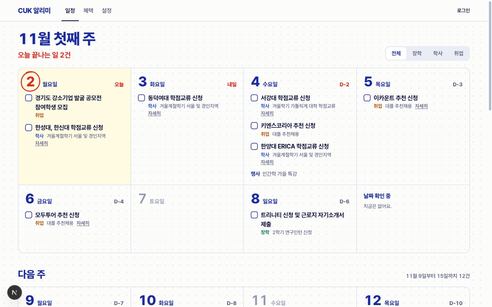
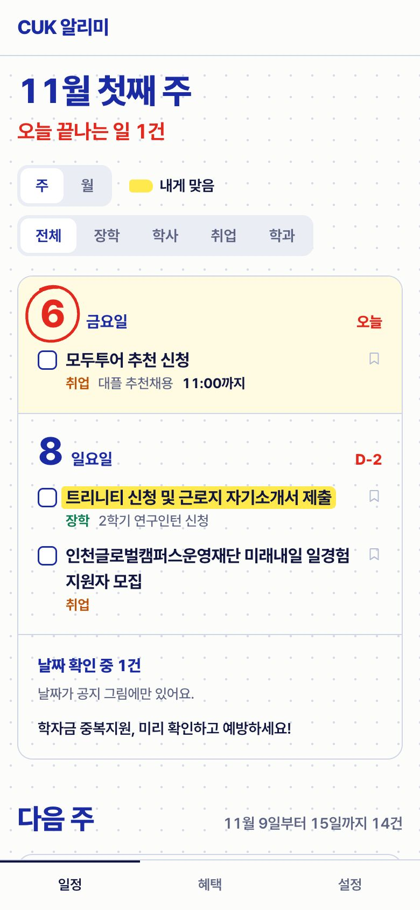
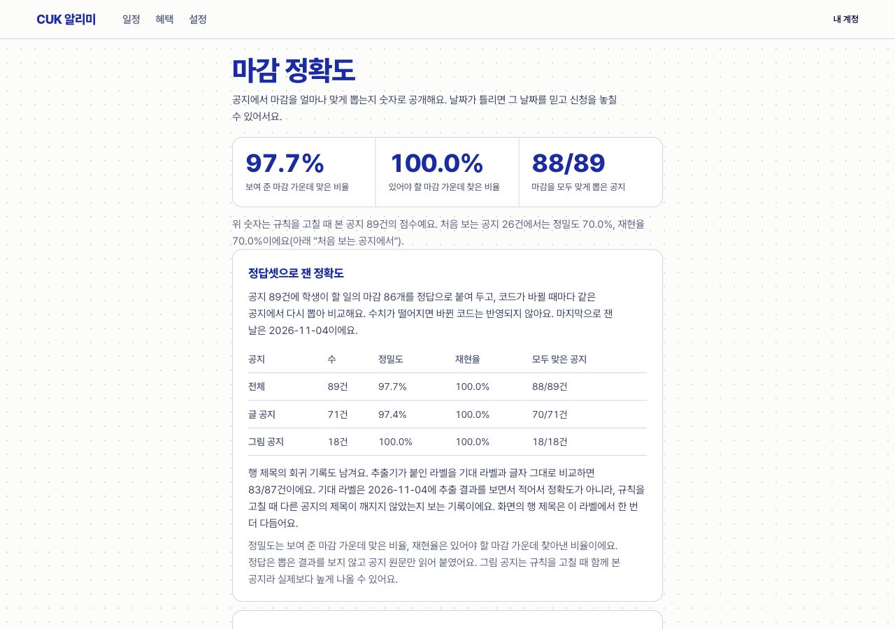

# CUK-Alimi

> A deadline tracker for Catholic University of Korea students. It collects school notices every hour, extracts the deadlines students must act on, and sends one morning email. Deadlines that only exist inside images are transcribed twice by Claude Haiku, parsed by the same rules, and published when both reads agree. Image-read dates carry a small "check" tag where students can report a wrong date. Extraction accuracy is measured on an 89-notice gold set in CI (precision and recall 0.977) and published on a public page.

가톨릭대 학생이 놓치기 쉬운 장학·학사 공지의 마감을 뽑아, 출처가 붙은 것만 홈과 아침 메일로 알려 주는 개인 서비스입니다.

## 문제

학교 공지 게시판은 올라온 순서대로만 보여 줍니다. 그런데 장학 공지는 대부분 특정 지역이나 계층만 낼 수 있어서(장학 31건 중 13건이 시·군·구 연고 조건), 내게 맞는 것을 찾으려면 전부 열어 봐야 합니다. 마감도 본문 문장이나 표, 그림 속에 흩어져 있고, 장학·학사 공지의 약 23%는 날짜와 자격이 그림이나 첨부에만 있습니다. 공지 알림 앱은 다른 학교에도 많지만, 살펴본 앱들(건국대 쿠링, 전남대 전대알림 등)은 새 글과 키워드 알림이 중심이고 마감을 뽑아 주지는 않았습니다.

## 서비스

아직 배포 전이고 사용자는 0명입니다. 주소가 생기면 여기에 적습니다. 배포를 막는 것은 학교 robots.txt 문의(초안 `docs/robots-inquiry.md`)와 실제 기기에서의 푸시 수신 확인이고, 둘이 정해지기 전에는 AI 키와 푸시 키 없이 올립니다.



| 휴대폰 | 공개 정확도 페이지 |
|---|---|
|  |  |

## 핵심 결정

1. **근거 없는 날짜는 보여 주지 않는다.** 원문 링크가 있고 규칙이 읽어 낸 날짜만 화면에 나옵니다. 날짜를 못 읽은 공지는 추측하지 않고 "날짜 확인 중"에 접어 둡니다 (ADR 003).
2. **AI는 글자만 옮기고 날짜는 규칙이 뽑는다.** 그림에만 날짜가 있는 공지는 Claude Haiku가 그림 글자를 그대로 받아 적고, 그 글을 글 공지와 같은 규칙에 넣습니다. AI에게 마감을 직접 물으면 그럴듯한 날짜를 지어내도 어디서 틀렸는지 알 수 없어서입니다. 같은 그림을 두 번 따로 읽어 날짜가 일치할 때만 자동으로 공개하고, 어긋나면 운영자에게 넘깁니다. 공개한 그림 날짜에는 행에 작은 "확인" 표시가 붙고, 학생이 "날짜가 달라요"를 누르면 바로 내리고 운영자가 고칩니다 (ADR 010).
3. **정확도는 정답셋으로 잰다.** 공지 89건에 정답 마감을 붙여 두고, 코드가 바뀔 때마다 CI에서 다시 뽑아 비교합니다. 정밀도나 재현율이 떨어지거나 분류되지 않은 새 오류가 생기면 빌드가 깨집니다. 결과는 공개 페이지(`/quality`)에 그대로 보입니다 (ADR 011).
4. **개인화는 판정이 아니라 표시다.** 연고 지역, 학기, 학과가 맞는 일에 형광펜을 칠하고, 좁은 대상의 공지는 지우지 않고 접습니다. 소득이나 성적 조건은 판정하지 않습니다. 형광펜은 "내 것일 수 있다"는 표시이고 자격은 원문에서 확인해야 합니다 (ADR 008, 009).
5. **AI는 대상 조건을 읽고 비교는 코드가 한다.** 공지가 들어오면 Claude Haiku가 학년·학과·연고 지역 조건을 두 번 따로 읽고, 같을 때만 씁니다. 학생 프로필은 AI에 보내지 않고 코드가 비교해 형광펜을 칠합니다. 칠한 이유는 캘린더 일정 설명과 그림 날짜 행의 "확인" 안에 있습니다. 처음에는 AI가 "4학기 이상 이수" 같은 학기 계산을 틀려 꺼 두었고, AI는 문장의 종류와 숫자만 옮기고 계산은 코드가 하도록 바꿨습니다. 지시문을 다듬을 때 보지 않은 공지 69건에 학생 2,700가지를 맞춰 재면 칠한 것 중 맞은 비율 91.4%, 칠해야 할 것 중 칠한 비율 50.8%로 정규식(71.9%, 21.4%)보다 낫습니다. 공지 단위로 모든 학생에게 맞게 칠한 수는 69건 중 54건 대 50건이라 차이는 네 건입니다. 정답지는 Opus가 적었고 그중 30건을 사람이 원문과 대조해 1건을 고쳤습니다 (ADR 013).
6. **운영비 0원.** Oracle 무료 VM 한 대에 Docker Compose로 올립니다. AI 비용은 그림 1장을 두 번 읽어 약 $0.0015, 공지 대상 조건은 한 건을 두 번 읽어 약 $0.0005이고, 둘 다 하루 상한을 둡니다 (ADR 006, 010, 013).

## 숫자

| 항목 | 값 |
|---|---|
| 마감 추출 정밀도 / 재현율 (정답셋 89건, 마감 86개) | 0.977 / 0.977 (처음 잰 값 0.886 / 0.886) |
| 글 공지 71건 | 0.973 / 0.973 |
| 그림 공지 18건 | 1.000 / 1.000 |
| 그림 받아 적기 비용 | 1회 약 $0.0007, 지금까지 15회에 $0.009 |
| 형광펜 (시험용 69건, 지시문 고칠 때 안 본 셋) | 칠한 것 중 맞음 91.4%, 칠해야 할 것 중 칠함 50.8%. 공지 단위로 모두 맞은 공지 54/69(정규식 50/69) |
| 행 제목 회귀 기록 (마감 87개) | 78/87이 기대 라벨과 같음. 기대 라벨은 추출 결과를 보고 적어 정확도가 아니다 |
| 사람이 확인한 정답 | 마감 10건, 형광펜 30건(1건 고침), 행 제목 0건 |

0.886에서 0.977로 올리는 동안 백테스트가 두 번 변경을 막았습니다. 한 번은 "까지 학점교류"의 "학점"을 "2.5학점" 같은 수치로 보고 마감을 버리던 숨은 버그였고, 한 번은 라벨러 사이에 갈린 정답 기준이었습니다.

## 한계

- 정답셋의 그림 공지 18건은 규칙을 고칠 때 함께 본 공지라 점수가 후하게 나옵니다. 새 공지에서는 더 낮을 수 있어, 새로 모이는 공지로 정답셋을 늘려 다시 잴 계획입니다.
- 마감 날짜 정답은 추출 결과를 보지 않는 AI 에이전트가 원문만 읽고 붙였고, 추출기와 엇갈린 건은 원문으로 다시 판정했습니다. 행 제목 정답(2026-11-04)은 추출 결과를 보고 썼기 때문에 정확도가 아니라 회귀 기록입니다. 사람은 무작위 10건만 확인했고, 9건이 맞았고 1건은 행사 날짜를 어떻게 다룰지 이의가 나왔습니다 (`docs/verification/2026-11-02-label-check.md`).
- 프로필 다섯 칸(입학년도, 이번 학기, 전공, 복수전공, 연고 지역)으로 "내 것"이라고 정직하게 말할 수 있는 공지는 24%뿐입니다. 완벽한 개인화는 되지 않습니다.
- 그림에서 읽은 날짜는 두 번 읽기가 일치하면 사람 확인 없이 공개됩니다. 같은 모델이 같은 글자를 똑같이 잘못 읽으면 틀린 날짜가 나갈 수 있고, 시험에서 어긋난 사례가 없어 오류 검출력은 아직 재지 못했습니다.
- 남은 오류는 문장 속 마감("10월 3일 오전까지 보내 주세요")과 특강 일정표입니다.
- 학교 `robots.txt`가 막는 경로에서 공지 그림을 받습니다. 학교에 문의할지, 끄고 배포할지는 배포 직전에 정합니다 (ADR 010).
- 아직 배포 전이라 실사용자 지표는 없습니다. 운영을 시작하면 검수 기록(`review_event`)이 같은 페이지에 쌓입니다.

## AI를 어떻게 썼나

**제품 안.** Claude Haiku는 옮겨 적는 일만 합니다. 그림 속 글자를 받아 적고, 공지의 대상 조건(학년·학기·학과·지역)을 정해진 형식으로 옮깁니다. 날짜 판단과 내 프로필 비교는 코드가 합니다.

**만드는 과정.** 구현, 조사, 코드 리뷰, 정답 라벨 초안에 AI 코딩 도구(Claude Code)를 썼습니다. 무엇을 만들고 무엇을 버릴지는 제가 정했고, 화면은 직접 써 보고 몇 번 뒤집었습니다. 결과는 테스트, 정답셋, 브라우저 확인으로 검증했습니다. 사람이 확인한 정답은 마감 10건, 형광펜 30건이고 행 제목은 아직 없습니다.

## 무엇을 하나요

- 학사일정(수강신청, 수강신청 변경, 등록기간, 휴학·복학, 성적 정정)과 공지사항의 장학·학사·취업 글에서 학생이 해야 할 일의 마감만 골라 보여줍니다. 공문 제목 대신 "서강대 학점교류 신청"처럼 할 일로 적고, 누르면 학교 원문으로 갑니다.
- 홈은 이번 주와 다음 주를 8칸 플래너로 펼칩니다. 이틀 안의 날짜는 빨갛게 표시되고, 끝낸 일은 체크해 지웁니다. 날짜가 그림에만 있어 확인 중인 공지는 메모 칸에, 다른 지역 장학과 특정 계층·분야 장학은 판 아래에 접어 둡니다.
- 대학생 자격으로 받는 혜택(개발 도구, 구독, 장학·학비)을 체크리스트로 관리합니다. 목록은 `src/main/resources/benefits.yml`에 있고, 항목마다 출처와 확인일이 붙어 있습니다.
- 컴퓨터정보공학부 게시판도 읽습니다. 그 학과 학생에게는 내게 맞는 공지로, 다른 학생에게는 접힌 구간으로 갑니다. 다른 학과는 사용자가 생기면 `app.notice.boards`에 더합니다.
- 캘린더 구독 주소를 구글·애플 캘린더에 넣으면 내게 맞는 마감과 저장한 마감이 자동으로 들어갑니다. 주소는 설정에서 새로 만들 수 있습니다.
- 알림은 아침 8시에 갑니다. 메일 한 통에 새 공지, 저장한 마감 3일 전, 체크한 혜택 만료 7일 전을 묶고, 푸시를 켠 기기에는 내게 맞는 마감과 저장한 마감의 3일 전과 하루 전만 따로 보냅니다. 푸시는 `VAPID_PUBLIC_KEY`와 `VAPID_PRIVATE_KEY`가 없으면 꺼집니다(키는 `VAPID_GEN=1 ./gradlew test --tests '*VapidKeyRun'`으로 한 번 만듭니다). 보낼 것이 없는 날은 보내지 않고, 같은 사건은 한 번만 갑니다.
- 그림 받아 적기는 `ANTHROPIC_API_KEY`를 주지 않으면 꺼집니다.

## 실행

JDK 21, Docker가 필요합니다.

```bash
cp .env.example .env            # 로컬 기본값. 비밀번호를 바꾸려면 여기서
docker compose up -d --wait postgres
./gradlew test                  # 저장해 둔 학교 페이지로 파서와 수집기를 검사하고, 정답셋 백테스트를 돈다 (Testcontainers가 Postgres를 띄움)
RUN_ONCE=all ./gradlew bootRun  # 학사일정과 공지를 한 번 수집하고 종료 (digest 를 주면 아침 알림을 한 번 보냄, transcribe 는 그림 받아 적기만)
./gradlew bootRun               # 상주 실행. 학사일정은 매일 06:00, 공지는 매시 07분에 수집, 아침 알림은 08:00
```

화면은 `web/`에 있습니다. Node 22가 필요합니다.

```bash
cd web && npm install
NEXT_PUBLIC_API_BASE=http://localhost:8080 npm run dev   # http://localhost:3000
npm run build                                           # out/ 에 정적 파일
```

로그인은 이메일 링크입니다. 로컬(`MAIL_MODE=console`)에서는 링크가 API 로그에 찍히니 그 주소를 브라우저에 붙여 넣으면 됩니다.
로컬에서 링크가 API를 가리키게 하려면 API를 `API_URL=http://localhost:8080` 으로 띄웁니다. 검수 화면은 `ADMIN_EMAIL`로 지정한 이메일 하나만 들어갈 수 있습니다.

```bash
ADMIN_EMAIL=you@example.com API_URL=http://localhost:8080 ./gradlew bootRun
```

수집 결과는 `date_item`(날짜 항목), `notice`(공지, 검수 상태), `notice_raw`(원문), `fetch_log`(요청 기록)에 쌓입니다.

```bash
docker exec cukalimi-postgres psql -U cukalimi -d cukalimi \
  -c "select title, starts_on, ends_on from date_item order by ends_on"
```

## 문서

- `docs/decisions/` 결정 기록. 무엇을 왜 골랐고 나중에 무엇이 바뀌었는지.
- `docs/verification/` 검증 기록. 무엇을 어떻게 확인했고 무엇이 남았는지.
- `src/test/resources/fixtures/gold/` 마감 추출 정답셋. 정답과 아직 못 고친 오류가 함께 적혀 있습니다.
- `docs/architecture.md` 수집에서 알림까지의 흐름.
- `docs/ops-log.md` 운영 일지. 사용자 수, 발송 수, 오류, 정정.
- `docs/ai-log/` AI 도구로 작업한 날의 계획과 리뷰 기록.
